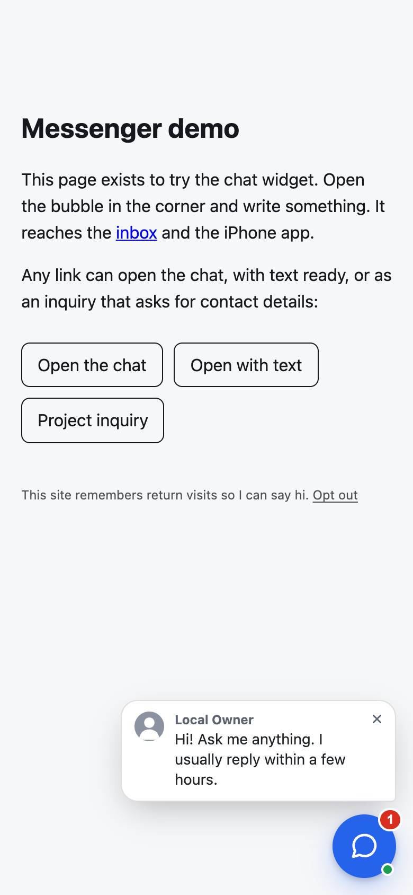
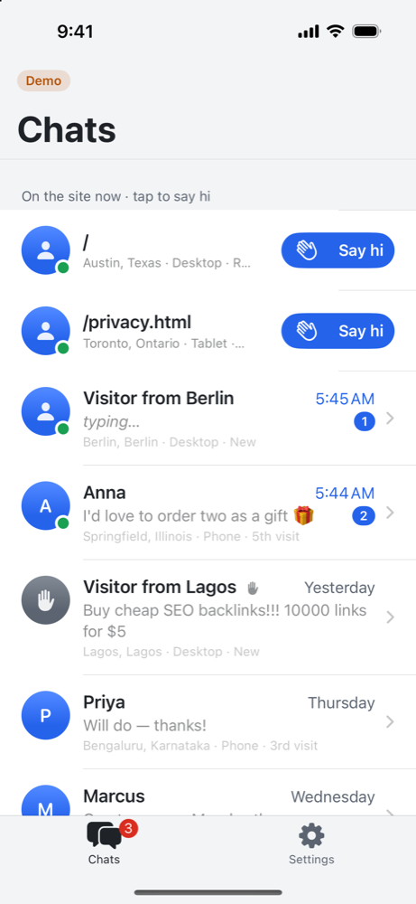
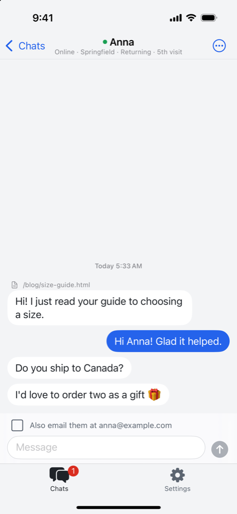

# Web Messenger

Live chat for your website that rings your iPhone. Visitors write in a small bubble on your site, and you answer from a web inbox or a native iOS app. It runs serverless in your own AWS account and costs about nothing at personal-site traffic.

| Widget | App: inbox | App: conversation |
|---|---|---|
|  |  |  |

- **One-tag widget.** A chat bubble with typing indicators, offline messages and inquiry forms. A reply that arrives while it's closed shows as a small preview above the button; it never opens itself. No dependencies.
- **Web inbox.** Reply, block, and set your availability from a browser. Sign-in is Google, limited to one account.
- **iPhone app.** SwiftUI, no third-party code. Time-sensitive alerts that keep ringing until you answer, and replies from the lock screen.
- **Your data.** One DynamoDB table in your account. No third-party chat service.
- **Spam limits.** Per-visitor and per-network rate limits, duplicate and link filtering, and bot refusal.
- **Optional email.** Mail to an address like `info@yourdomain` can land in the same inbox.

## How it fits together

```
  your site  ── <script> ──▶ widget ──┐
                                      ├─ WebSocket API ─┐
  web inbox ─────────────────────────┤                  ├─▶ one Lambda ─▶ DynamoDB
  iPhone app ─────────────────────────┴─ HTTP API ──────┘        │
       ▲                                                         ├─▶ SQS (reminders)
       └────────────── Apple push (APNs) ◀───────────────────────┘
```

| Path | What it is |
|---|---|
| `aws/chat/src/` | The Lambda (Node 22, no runtime dependencies beyond the AWS SDK that Lambda provides) |
| `aws/chat/src/public/` | The widget (`chat.js`, `chat.css`), the inbox page and a demo page, all served by the Lambda |
| `aws/chat/template.yaml` | The whole stack as one AWS SAM template |
| `aws/deploy.sh` | Stores secrets, deploys, prints your addresses |
| `tools/chat-dev.mjs` | The local bench |
| `ios/` | The iPhone app ([ios/README.md](ios/README.md)) |
| `docs/chat-protocol.md` | The contract between all the parts |
| `docs/deploy.md` | Deploying to the web, step by step |
| `docs/release.md` | Release checklist: what the test workflow checks, what is by hand, gates, rollback |
| `docs/embed.md` | The embed API for sites that use the widget, and how to theme it |
| `docs/decisions.md` | Decisions, dated |

## Try it locally

You need Node 22 or later. No AWS account or Apple account is required.

```sh
npm install
npm test          # unit tests
npm run smoke     # a real end-to-end conversation over sockets
npm run dev       # the local bench
```

With `npm run dev` running, open these two pages side by side:

- http://localhost:8790/demo is a page with the widget. Write something.
- http://localhost:8790/ is the inbox, already signed in. Reply.

Pushes print in the terminal instead of going to Apple. Set `REMIND_S=10` to hear reminders sooner.

### Test closer to production

The bench runs the same Lambda code path as AWS, with API Gateway shaped events. By default it keeps data in memory. To test against a real DynamoDB engine with the same table design (this needs Docker):

```sh
npm run db:up
npm run dev:dynamo
SMOKE_BASE=http://localhost:8790 npm run smoke    # in a second terminal
npm run db:down
```

To lint the template before a deploy:

```sh
uvx cfn-lint aws/chat/template.yaml    # or: pip install cfn-lint
```

Two warnings about the empty `CertificateArn` default are expected.

### What local testing doesn't cover

API Gateway itself, IAM permissions, Google sign-in and real Apple pushes only run on AWS. [docs/deploy.md](docs/deploy.md) ends with a checklist for those.

### Try the app locally

See [ios/README.md](ios/README.md). The app has a Demo mode that needs no server, and it can connect to the local bench from the Simulator.

## Deploy to the web

See [docs/deploy.md](docs/deploy.md). In short:

```sh
cp deploy.env.example deploy.env       # your values; gitignored
bash aws/deploy.sh secrets
bash aws/deploy.sh deploy
```

Then add one line to your site:

```html
<script src="https://YOUR-API/widget/chat.js" defer></script>
```

## Customize the widget

The full, stable embed API (everything a site may rely on, and the promise not to break it) is [docs/embed.md](docs/embed.md). The short version:

Set any of these before the script tag:

```html
<script>
  window.WM_CONFIG = {
    ownerName: "Your Name",
    ownerPhoto: "https://example.com/you.jpg",
    privacyUrl: "/privacy.html",
    greeting: "Hi! How can I help?"
  };
</script>
```

Add `data-chat-open` to any link to make it open the chat. `data-chat-prefill="text"` fills in the message, and `data-lead="Project"` asks for contact details.

Add `<p id="wm-privacy-line"></p>` to your footer for the opt-out line. Visit `yoursite.com/#me` once on your own devices so your visits aren't announced.

## Theming

The project ships with one plain default look: light and dark, a blue accent, the system font. It is made to be replaced.

**The widget.** Every colour and the font are CSS variables on `.wmc`. They are all declared in one commented block at the top of [`aws/chat/src/public/chat.css`](aws/chat/src/public/chat.css); nothing else in the widget's CSS or JavaScript contains a colour. Restyle it from the page that embeds it, anywhere in that page's own CSS, without touching the widget's files:

```html
<style>
  .wmc {
    --accent: #0f766e;  --on-accent: #ffffff;   /* launcher, header, the visitor's bubbles, send button */
    --paper: #fffdf8;   --plate: #f4efe6;       /* panel background, message list background */
    --ink: #1c1917;     --quiet: #6b645c;       /* text, secondary text */
    --font: Georgia, "Times New Roman", serif;
  }
  @media (prefers-color-scheme: dark) {
    .wmc { --accent: #2dd4bf; --on-accent: #042f2e; --paper: #1c1917; --plate: #141210; --ink: #f1ece4; --quiet: #a8a29a; }
  }
</style>
```

| Variable | Used for |
|---|---|
| `--font` | All widget text |
| `--accent`, `--on-accent` | Launcher button, header, the visitor's own bubbles, send button, focus rings; and the text on them |
| `--paper`, `--plate` | Panel and form background; message list background |
| `--ink`, `--quiet` | Text; secondary text and placeholders |
| `--line`, `--line-strong` | Thin borders; stronger borders and underlines |
| `--bubble`, `--bubble-line` | The owner's message bubbles, the preview bubble and the "Chat with me" pill; their border |
| `--field-bg`, `--field-line` | Text fields; their border |
| `--online`, `--offline` | The availability dot on the launcher |
| `--badge`, `--on-badge` | The unread badge and its number |
| `--avatar-bg`, `--avatar-fg` | The default avatar, shown when no `ownerPhoto` is set |
| `--shadow` | The colour of all drop shadows |

Light is the default and dark follows the visitor's system setting (`prefers-color-scheme`). Any variable you don't set keeps the default for that mode, so set both modes when you change a colour. To keep the widget light on a site that has no dark mode, repeat your light values inside the dark media query. The same list, with the promise that these names stay, is in [docs/embed.md](docs/embed.md#3-theming).

**The inbox page.** Its colours are the variables in the `:root` block at the top of [`aws/chat/src/public/inbox.html`](aws/chat/src/public/inbox.html).

**The iPhone app.** Its colours and font are in one file, [`ios/WMChat/Support/Theme.swift`](ios/WMChat/Support/Theme.swift); see [ios/README.md](ios/README.md#theming).

## Privacy: what you should tell your visitors

If you run this on a public site, your privacy policy should say so, and the law where you and your visitors are may require more.

- **Live typing.** The owner sees a message as it's typed, before it's sent. The widget says so under the message box.
- **Return visits.** A random id in `localStorage` remembers visitors for 400 days after their last visit, along with their device type, pages, referrers and IP addresses.
- **Consent.** Visitors can opt out, Global Privacy Control is honored, and time zones in the EEA, UK and Switzerland must opt in first. That check uses the browser's time zone, so treat it as a sensible default rather than legal compliance.
- **See and delete.** A visitor can download everything stored under their id and delete it: `window.wmChat.myData()` and `window.wmChat.forget()`, backed by `POST /visitor/data` and `POST /visitor/forget` ([docs/chat-protocol.md](docs/chat-protocol.md#the-visitors-own-data-http-no-sign-in)). Put buttons for them on your privacy page. What can't be deleted by id (short-lived spam counters, 90-day Lambda logs) is listed there too.

## Cost

Roughly a dollar a month or less at low traffic. API Gateway, Lambda, DynamoDB and SQS are pay-per-use, and SSM parameters are free. Long-open visitor sockets count as API Gateway connection minutes, which is the main thing that grows with traffic.

## Security

See [SECURITY.md](SECURITY.md).

## License

[MIT](LICENSE)
